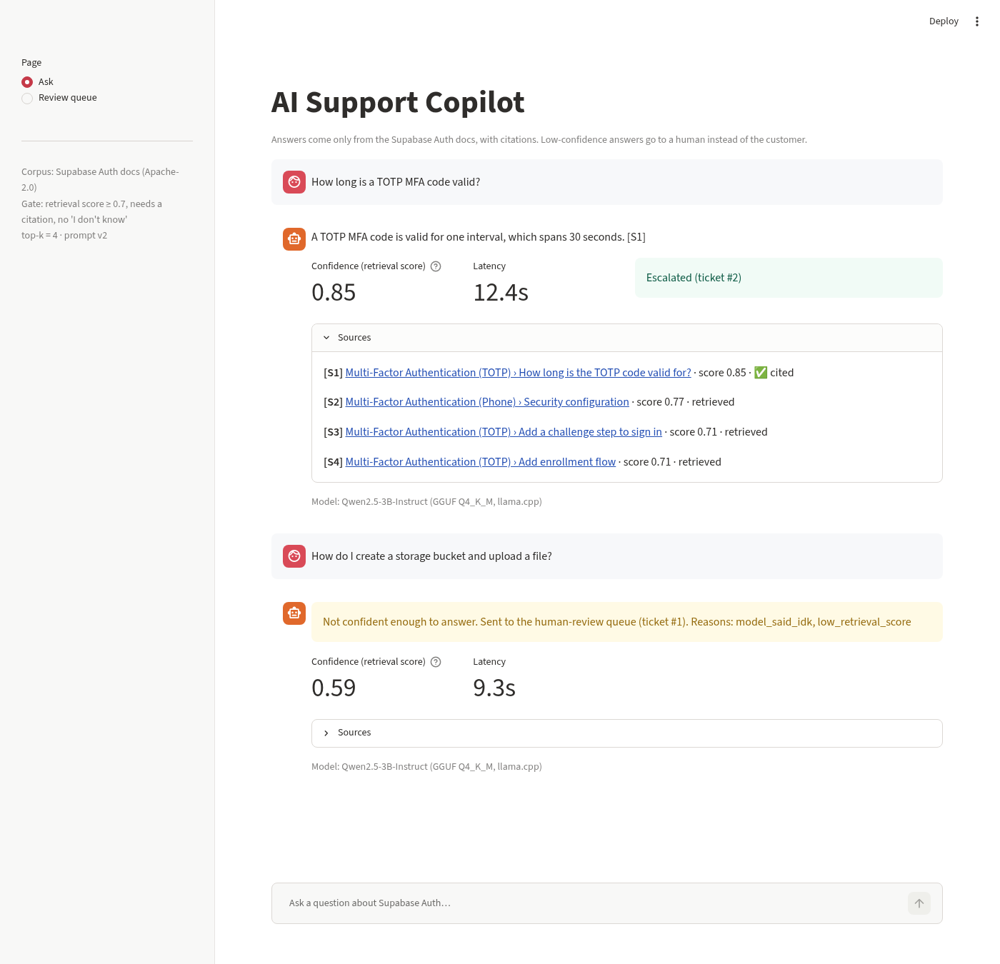
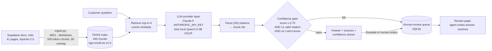

# AI Support Copilot — RAG over Supabase Auth docs, with a confidence gate, human review, and an eval harness

**Author:** Krupa Nirmal · Portfolio project (product + prototype + evaluation). See also the 1-page [PRD](PRD.md).

**Demo:** not hosted yet. Free CPU hosting for a 3B model now needs a paid plan, so see the screenshots below or run it locally (instructions further down).



## 1. Problem
Support teams answer the same documentation questions again and again. An LLM can answer them, but a confident wrong answer about authentication settings can break a customer's login flow. So the bar is not only "answers questions". It is:
1. Answer **only from the docs**, and **cite** the passage.
2. **Know when not to answer.** Low-confidence questions go to a **human-review queue** instead of the customer.
3. **Measure it** before launch: pass rate, hallucination, citation accuracy, escalation, latency and cost, all on a fixed eval set.

## 2. What's in the repo
| Path | What |
|---|---|
| `data/raw/` | 41 Supabase Auth docs pages (`.mdx`, Apache-2.0) pinned to one commit, plus a `manifest.json` |
| `data/SOURCES.md` | License, repository commit, and source URL for every page |
| `data/docs/` | The same pages converted to Markdown |
| `data/index/` | Chunk metadata, stats, and the FAISS index (rebuild with `python -m copilot.ingest`) |
| `copilot/` | ingest → retrieve → prompt → LLM provider layer → confidence gate → review queue → eval harness |
| `app.py` | Streamlit UI: chat, cited sources, confidence score, "Escalate to human", review-queue page |
| `eval/questions.csv` | 50 eval questions: 30 answerable, 10 partially answerable, 10 out-of-scope |
| `eval/calibration/` | DEV queries (not in the eval set) used to pick the gate threshold |
| `eval/results/<run>/` | Raw outputs of every reported run: generations, judgments, per-question CSV, metrics, spot-check sheet |
| `config.yaml` | Every knob: chunk size, top-k, prompt version, models, gate threshold |

## 3. Architecture


## 4. Design decisions
- **Corpus: Supabase Auth docs only.** One product, one domain. It's public and Apache-2.0 licensed, and it's realistic support material (limits, defaults, error messages). Pages were taken from `apps/docs/content/guides/auth/` at commit `c8aad26`. The selection rule is in [data/SOURCES.md](data/SOURCES.md). Partials and the `<SharedData>` values (for example rate limits) are inlined, so numbers like "2 emails per hour" are in the text and don't render as blank template variables.
- **Chunking:** split on `##`/`###` headings, then pack paragraphs up to **500 tokens** (counted with the embedding model's tokenizer), with **80 tokens of overlap** between consecutive chunks of the same section. The result is 449 chunks, 255 tokens on average, since many sections are shorter than 500.
- **Retrieval:** `BAAI/bge-small-en-v1.5` (local, CPU) + FAISS inner product on normalised vectors. Each chunk is embedded with a "page title › section" prefix.
- **Generation:** the system prompt requires a citation for every claim, allows "I don't know", and asks the model to say which part of a question the docs don't cover. Passages are labelled `[S1]…[S4]` in the prompt and mapped back to chunk ids. Why: in informal smoke tests (not saved; 3 questions with chunk-id labels, then 4 with `[S#]` labels), Qwen2.5-1.5B never cited anything, so the generator was moved up to Qwen2.5-3B, and short labels were kept because they are easier for a small model to copy.
- **Provider layer (`copilot/llm.py`):** if `ANTHROPIC_API_KEY` is set, generator and judge use Claude (`claude_model` in config). Otherwise they use local GGUF models via llama.cpp. **All numbers below are from the local models, because no API key was available.** Every result row records the model that produced it.
- **Confidence gate (`copilot/pipeline.py::apply_gate`).** An answer is shown only if all three conditions hold:
  1. The top retrieval cosine score is ≥ `gate.min_retrieval_score`, which is **0.70**. This was set from [8 in-scope + 8 out-of-scope DEV queries](eval/calibration/dev_scores.json) that are not in the eval set. In-scope DEV scores ranged from 0.706 to 0.883 and out-of-scope from 0.566 to 0.779, so 0.70 keeps every in-scope DEV query and blocks half the out-of-scope ones. The model's own "I don't know" covers the rest.
  2. The answer cites at least one retrieved chunk.
  3. The model didn't say "I don't know".

  Anything else is written to the review queue with the draft and the gate reasons. The score is retrieval similarity, not a calibrated probability. That's a deliberate, simple first version (see Limitations).
- **Human-review queue:** a SQLite table (`copilot/review_queue.py`). It holds gate failures (`source=gate`) and button escalations (`source=user`). Reviewers resolve items with an answer on the review page.

## 5. Evaluation method
- **Eval set (`eval/questions.csv`, 50 items):** **these questions were written for this project from the docs, not taken from real user logs.** Each item has a question, expected answer, expected source page(s), and a category:
  - 30 **answerable**
  - 10 **partially answerable**: one part is in the docs and one part is not, such as a price or a country list
  - 10 **out-of-scope**: other Supabase products, billing, general Postgres
- **One command:** `python -m copilot.evaluate --run-name <name>`. Per question it records the answer, retrieved chunks, gate decision, latency and tokens. Then a judge model grades every substantive (non-"I don't know") answer.
- **LLM-as-judge rubric:** `correct` / `partially correct` / `wrong` / `hallucinated`, output as constrained JSON. The judge is a different model family from the generator, to reduce self-preference.
- **Metrics:**
  - **Pass rate:** an in-scope question passes only if the answer was *shown* and judged *correct*. An out-of-scope question passes if it was *not shown* (escalated).
  - **Hallucination rate:** the share judged hallucinated, among answers shown to the user and among all drafts.
  - **Citation accuracy:** among shown in-scope answers, the share that cite at least one chunk from an expected source page.
  - **Escalation rate** and **retrieval hit rate @k**.
  - **Median and p90 end-to-end latency.**
  - **Cost per 100 queries:** token usage × price for Claude. It is $0 for local models, which excludes hardware and electricity.
- **Human spot check:** each run exports `spot_check.csv`, a seeded 20% sample stratified by category (10 items), with blank `human_label` columns. **It has not been filled in yet.** Judge agreement is unverified until someone completes it.

## 6. Results (measured)
All runs used **generator Qwen2.5-3B-Instruct (GGUF Q4_K_M, llama.cpp)**, **judge Phi-3.5-mini-instruct (GGUF Q4_K_M, llama.cpp)** and **embeddings bge-small-en-v1.5**, on an 8-vCPU Linux box with no GPU, at temperature 0, on 11 Nov 2026 (IST).

**One iteration.** The single change was the **prompt: v1 → v2**, with retrieval, chunking, gate and models unchanged. It was chosen from the baseline failure review. The biggest failure bucket was correct answers that left out the `[S#]` citation, so the gate escalated them: 5 of the 7 escalated answerable questions were correct drafts with no citation (q09, q16, q17, q28, q29). Partially answerable questions also often ended with an invented fill-in. v2 requires a citation on every sentence, a "does the context address this?" check, and a fixed phrase for uncovered parts. Prompt text is in `copilot/prompts.py`.

| Metric | baseline (prompt v1) | iter1 (prompt v2) |
|---|---|---|
| **Pass rate (all 50)** | **58.0%** | **78.0%** |
| answerable (30) | 60.0% | 86.7% |
| partially answerable (10) | 20.0% | 40.0% |
| out-of-scope (10) | 90.0% | 90.0% |
| **Hallucination rate, answers shown to user** | **3.3%** (1/30) | **2.7%** (1/37) |
| Hallucination rate, all judged drafts | 2.6% (1/39) | 9.1% (4/44) * |
| Accuracy of answers shown | 66.7% | 81.1% |
| **Citation accuracy** (shown, in-scope) | 96.5% | 97.2% |
| **Escalation rate (all 50)** | 40.0% | 26.0% |
| escalation, answerable | 23.3% | 3.3% |
| escalation, out-of-scope | 90.0% | 90.0% |
| Retrieval hit rate @4 (in-scope) | 100.0% | 100.0% |
| **Median latency** | 11.94 s | 11.70 s |
| p90 latency | 16.73 s | 15.67 s |
| **Cost per 100 queries** | $0 (local) | $0 (local) |

Source files: [baseline](eval/results/baseline/metrics.json), [iter1](eval/results/iter1_prompt_v2/metrics.json), and [comparison.md](eval/results/comparison.md), which `scripts/compare_runs.py` generates from those files. Per-question rows are in each run's `results.csv`.

\* The rise in "all drafts" hallucination is partly a measurement artifact. Two of the four are long "I don't know…" replies (q44, q49) that went past the 200-character abstention rule, so the judge graded them and labelled them hallucinated. The other two are real fabrications: a "$75/month" Pro price in q32 and a "$85" Team plan price in q48. Of all four, only q48 reached the user. The rest were escalated by the gate.

**Gate threshold replay** (`scripts/threshold_sweep.py`, in-sample, no new model calls): on the iter1 outputs, a threshold of 0.75 would have produced 0 hallucinations shown to users, a 74% pass rate and 36% escalation, compared with 2.7%, 78% and 26% at 0.70. Full table: [threshold_sweep.csv](eval/results/iter1_prompt_v2/threshold_sweep.csv). This is a lead to re-test on new questions, not a held-out result.

**What the failure review showed** (from the raw `results.csv`, not a human spot check):
- The remaining shown errors are mostly confident mis-statements the gate can't see. q22 starts "Yes, Supabase supports SLO…" and then says it isn't supported. q36 invents "100 MAUs" for the Free plan.
- The judge looks lenient. It labelled q36 `wrong` rather than `hallucinated`, and q22 `wrong` despite the self-contradiction. The hallucination rate is probably undercounted, which is one more reason for the human spot check.

## 7. Launch bar (proposal)
These targets are proposed, not achieved. The thresholds live in `config.yaml`, so the bar can be tightened without code changes.

| Gate metric | Proposed bar | iter1 (measured) | Met? |
|---|---|---|---|
| Hallucination rate, shown answers | ≤ 1% | 2.7% | ❌ |
| Pass rate, answerable | ≥ 90% | 86.7% | ❌ |
| Out-of-scope correctly escalated | ≥ 95% | 90.0% | ❌ |
| Citation accuracy | ≥ 95% | 97.2% | ✅ |
| Escalation rate, answerable (support load) | ≤ 15% | 3.3% | ✅ |
| Median latency | ≤ 5 s | 11.7 s (CPU, local 3B model) | ❌ |
| Human spot check agrees with the judge | ≥ 90% of 10 items | not done yet | — |

**Verdict: not launch-ready on the local model.** Next is a Claude re-run (one command) and a held-out question set before deciding.

## 8. Limitations
- **Small local models.** The 3B generator ignores instructions sometimes, for example by dropping citations or contradicting itself. The **Phi-3.5-mini judge is weak**: it looks lenient on hallucinations and gave long "I don't know" replies a label. Treat the judge labels as noisy until the spot-check sheet is filled in and/or a stronger judge is run.
- **Small, self-written eval set (50).** One question moves a category rate by 3.3 to 10 points. The questions were written by the project author, so they may be easier than real tickets. The same set was used to compare v1 and v2, and there is no held-out set yet.
- **Confidence = retrieval similarity.** In-scope and out-of-scope scores overlap: the DEV out-of-scope maximum is 0.779 and the minimum in-scope is 0.706. q48 (Team plan price) passed the gate at 0.748 because a phone-MFA pricing chunk looked similar. A real system would add an answer-level signal such as an NLI/groundedness check or self-consistency.
- **Citation parsing is strict.** Only `[S1]`-style labels count. Forms like `[Source S1]` aren't parsed, so a few answers are escalated even though they did cite.
- **Abstention detection** is a regex plus a length limit under 200 characters. Long "I don't know…" replies slip past it.
- Latency is CPU-only on a shared 8-vCPU box. It isn't representative of a hosted API.
- Docs are pinned to one commit. Limits such as the default email rate change over time, and the corpus has to be re-ingested to stay current.

## 9. How to run
To run the app locally:
```bash
# Python 3.12
uv venv -p 3.12 .venv && source .venv/bin/activate
uv pip install -r requirements.txt --index-strategy unsafe-best-match \
  --extra-index-url https://download.pytorch.org/whl/cpu \
  --extra-index-url https://abetlen.github.io/llama-cpp-python/whl/cpu
./scripts/download_models.sh                 # ~4.4 GB of local models

python -m copilot.ingest                     # MDX → Markdown → chunks → FAISS
streamlit run app.py                         # UI on http://localhost:8501

# Evaluation (local models; ~13 min per run on 8 vCPUs)
python -m copilot.evaluate --run-name baseline --force-local --set generation.prompt_version=v1
python -m copilot.evaluate --run-name iter1_prompt_v2 --force-local --set generation.prompt_version=v2
python scripts/compare_runs.py baseline iter1_prompt_v2 > eval/results/comparison.md
python scripts/threshold_sweep.py iter1_prompt_v2

# Same eval with Claude as generator + judge (one command; costs are computed from token usage)
ANTHROPIC_API_KEY=sk-... python -m copilot.evaluate --run-name claude_v2
```
Check `generation.claude_model`, `judge.claude_model` and `pricing_usd_per_mtok` in `config.yaml` against Anthropic's current model list and prices before a Claude run.

`python scripts/calibrate_threshold.py` re-creates the DEV calibration. `python scripts/screenshot.py --escalate-first --question "..."` re-creates the screenshots; it needs the app running and Chrome.

## 10. What I'd ship next
1. **Re-run with Claude** as generator and judge, fill in the 10-item human spot check, and report judge agreement.
2. **Add an answer-level groundedness check** to the gate, for example "is each cited sentence supported by its chunk?". This targets shown hallucinations like q48 and q36, which retrieval similarity can't catch.
3. **Build a held-out set of about 100 questions**, ideally from real (anonymised) tickets, then re-tune the threshold. The 0.75 setting looked safer in the in-sample replay.
4. **Make citation and abstention parsing robust** (`[Source S1]`, long "I don't know"), and log every gate reason as a product metric.
5. **Close the loop:** resolved review-queue answers become new eval items and FAQ candidates. Track escalation rate and time-to-resolve weekly.
6. **Run a shadow launch** to support agents first (agent-assist), before showing answers to customers directly.

## 11. Screenshots
- Chat: `docs/screenshot_chat.png` shows an answer with a cited source, the confidence score, the button escalation (ticket #2), and an out-of-scope question auto-escalated by the gate (ticket #1).
- Review queue: `docs/screenshot_review_queue.png`

## License
Code: MIT. The docs in `data/raw/` and `data/docs/` are © Supabase and licensed under Apache-2.0 (see `data/raw/LICENSE-supabase-Apache-2.0.txt`).
